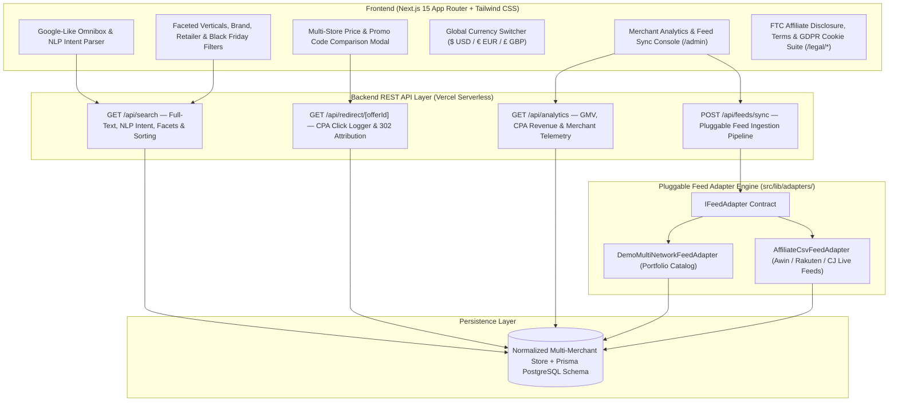

<div align="center">

# VeloraScout
### Multi-Brand Fashion, Cosmetics & Beauty Deal Meta-Search Engine

<p align="center">
  <a href="https://velora-scout.vercel.app">
    
  </a>
  &nbsp;
  <a href="https://velora-scout.vercel.app/admin">
    
  </a>
  &nbsp;
  <a href="https://github.com/aymanmali/velora-scout/actions">
    
  </a>
</p>

<p align="center">
  
  &nbsp;
  
  &nbsp;
  
  &nbsp;
  
</p>

</div>

---

## Overview

**VeloraScout** is a full-stack, Google-style shopping and deal meta-search engine that indexes, normalizes, and compares real-time prices, **Black Friday / Cyber Week discounts**, and verified promo codes across global **Clothes, Fashion, Cosmetics, Makeup, Skincare, and Fragrance** retailers (*Sephora, Cult Beauty, ASOS, Nordstrom, Ulta Beauty, Selfridges, Zalando, and Farfetch*).

It combines a **Natural Language Search Intent Parser**, a **Multi-Retailer Price & Coupon Comparison Engine**, a **Pluggable `IFeedAdapter` Datafeed Pipeline** (`Awin`, `Rakuten Advertising`, `CJ Affiliate`, `Impact`, `Partnerize`), and a **Real-Time Attribution & Analytics Console** (`/admin`).

### Live Deployment Links
* **Primary Full-Stack Application (Vercel):** [https://velora-scout.vercel.app](https://velora-scout.vercel.app)
* **Merchant & Affiliate Analytics Console:** [https://velora-scout.vercel.app/admin](https://velora-scout.vercel.app/admin)
* **GitHub Pages Static Mirror:** [https://aymanmali.github.io/velora-scout/](https://aymanmali.github.io/velora-scout/)

---

## System Architecture



---

## Core Engineering Highlights

### 1. Google-Style Meta-Search & Natural Language Intent Parser
* **Instant Omnibox (`/` keyboard shortcut):** Full-text search across 18+ fashion & beauty brands, 25 canonical products, and 73+ competing retailer offers.
* **Conversational Filter Extraction:** Queries such as `"waterproof mascara under $30"` or `"Black Friday skincare 40% off"` are parsed in real time by `parseSearchIntent()` to automatically apply structured constraints (`Max Price: $30`, `40%+ Off`, `Black Friday Deal`).
* **Multi-Vertical Facets:** Instant filtering across **Clothes & Fashion**, **Makeup & Cosmetics**, **Skincare & K-Beauty**, **Luxury Fragrance**, and **Beauty Tech & Hair**.

### 2. Multi-Retailer Price Comparison & Global Currency Engine
* **Canonical Product Aggregation:** Groups competing offers for the same product across up to 4 retailers side-by-side, ranking the winning store by lowest checkout price and deepest discount percentage.
* **One-Click Promo Code Copy:** Interactive coupon chips (`BFGLOW45`, `FENTY50BF`, `WINTER50`, `AVIATOR50`) with clipboard feedback.
* **Multi-Currency Conversion:** Instant switching between **`$ USD`**, **`€ EUR`**, and **`£ GBP`**.

### 3. Commercial Affiliate Attribution & Publisher Console (`/admin`)
* **Click-Out Attribution Gateway (`GET /api/redirect/[offerId]`):** Logs each outbound click event, computes estimated CPA commission (`salePriceUsd * commissionRate`), and constructs tracked affiliate URLs (`utm_source=velorascout`, `aff_network`, `click_id`).
* **Live Analytics Dashboard:** Real-time KPI cards (Outbound Affiliate Clicks, Referred GMV, Estimated Publisher Commission, Average Discount Depth), merchant performance table, live click stream, and an interactive **"Run Feed Sync Pipeline"** trigger.

---

## REST API Reference

| Method | Endpoint | Description |
| :--- | :--- | :--- |
| `GET` | `/api/search` | Full-text search, NLP intent parsing, faceted filtering (`q`, `category`, `brand`, `merchant`, `minDiscount`, `blackFriday`, `hasPromo`, `freeShipping`, `sort`). |
| `GET` | `/api/redirect/[offerId]` | Logs commercial `ClickEvent`, computes CPA commission, and returns attribution receipt JSON (`mode=json`) or HTTP 302 redirect (`mode=redirect`). |
| `GET` | `/api/analytics` | Aggregates publisher KPIs, merchant CPA performance, recent click stream, and feed sync history. |
| `POST` | `/api/feeds/sync` | Executes the active `IFeedAdapter` ingestion pipeline and updates catalog offer timestamps. |

---

## Repository Structure

```text
velora-scout/
├── prisma/
│   └── schema.prisma                      # Production relational schema (PostgreSQL / SQLite)
├── src/
│   ├── app/
│   │   ├── page.tsx                       # Google-like Meta-Search UI & Multi-Store Deal Grid
│   │   ├── admin/page.tsx                 # Publisher Analytics, Click Stream & Feed Sync Console
│   │   ├── legal/[slug]/page.tsx          # FTC Affiliate Disclosure, Terms & Privacy Policy
│   │   └── api/
│   │       ├── search/route.ts            # Full-text search, NLP intent & faceted filtering API
│   │       ├── redirect/[offerId]/route.ts# Affiliate click logger & attribution redirector
│   │       ├── analytics/route.ts         # KPI & merchant performance aggregation API
│   │       └── feeds/sync/route.ts        # Pluggable feed ingestion webhook
│   ├── components/
│   │   ├── Navbar.tsx                     # Header with FTC disclosure bar & Currency Switcher
│   │   ├── CompareModal.tsx               # Side-by-side multi-retailer price comparison modal
│   │   ├── RedirectModal.tsx              # Commercial attribution receipt & checkout redirect
│   │   ├── CookieBanner.tsx               # GDPR / CCPA affiliate cookie consent manager
│   │   └── Footer.tsx                     # Legal notices & IP attribution footer
│   └── lib/
│       ├── adapters/
│       │   ├── types.ts                   # IFeedAdapter contract & domain types
│       │   ├── demo-adapter.ts            # Multi-brand Black Friday portfolio catalog adapter
│       │   └── affiliate-csv-adapter.ts   # Commercial Awin / Rakuten / CJ feed adapter
│       ├── seed-data.ts                   # 18 Brands, 8 Retailers, 25 Canonical Products, 73+ Offers
│       ├── currency.ts                    # USD / EUR / GBP conversion utility
│       ├── client-engine.ts               # Hybrid client fallback engine for static mirrors
│       └── db.ts                          # Server search engine, intent parser & attribution store
└── .github/workflows/
    ├── ci.yml                             # GitHub Actions CI (TypeScript + Next.js Production Build)
    └── deploy-pages.yml                   # Automated GitHub Pages mirror deployment
```

---

## Local Development

```bash
# 1. Install dependencies
npm install

# 2. Start the Next.js development server
npm run dev
```

Open [http://localhost:3000](http://localhost:3000) to test the meta-search interface, or [http://localhost:3000/admin](http://localhost:3000/admin) to inspect the publisher analytics console.

