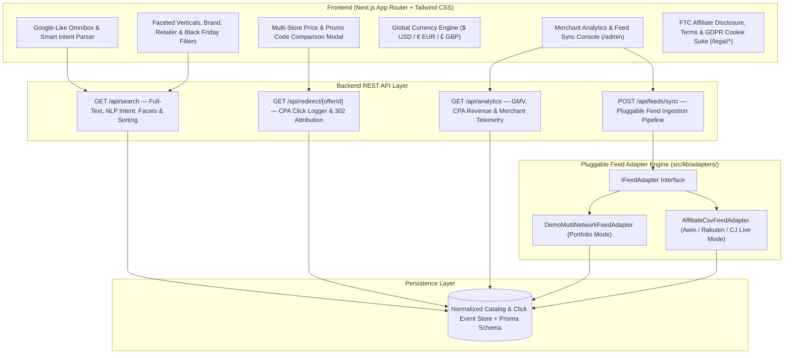

# AuraDeals — Multi-Brand Fashion, Cosmetics & Beauty Deal Meta-Search Engine

[](./.github/workflows/ci.yml)
[](https://nextjs.org/)
[](https://www.typescriptlang.org/)
[](https://tailwindcss.com/)
[](./prisma/schema.prisma)

**AuraDeals** is a full-stack, Google-style shopping & deal meta-search engine built to aggregate and compare real-time prices, **Black Friday / Cyber Week discounts**, and verified promo codes across global **Clothes, Fashion, Cosmetics, Makeup, Skincare, and Fragrance** retailers (*Sephora, Cult Beauty, ASOS, Nordstrom, Ulta Beauty, Selfridges, Zalando, and Farfetch*).

Designed with a **dual-purpose architecture**:
1. **Engineering Portfolio & System Design Showcase**: Clean full-stack Next.js App Router architecture, natural-language query intent parsing, faceted search API, real-time click attribution telemetry, and zero-config serverless deployment.
2. **Commercial Affiliate Production-Ready**: Implements a pluggable `IFeedAdapter` ingestion layer (`Awin`, `Rakuten Advertising`, `CJ Affiliate`, `Impact`, `Partnerize`), outbound affiliate attribution logging (`/api/redirect/[offerId]`), and full FTC / EU / GDPR legal compliance pages.

---

## System Architecture



---

## Key Features

### 1. Google-Style Meta-Search & Natural Language Intent Parser
- **Instant Omnibox (`/` shortcut)**: Search across brands, product titles, categories, ingredients, or retailer names.
- **Smart Query Intent Detection**: Typing natural language queries like `"waterproof mascara under $30"` or `"Black Friday skincare 40% off"` automatically extracts and applies structured filters (`Max Price: $30`, `40%+ Off`, `Black Friday Deal`).
- **Multi-Vertical Facets**: Filter across **Clothes & Fashion**, **Makeup & Cosmetics**, **Skincare & K-Beauty**, **Luxury Fragrance**, and **Beauty Tech & Hair**.

### 2. Multi-Brand Price Comparison & Promo Code Engine
- Each canonical product aggregates offers from multiple competing retailers side-by-side.
- Automatically computes the **Winning Offer (Lowest Price)**, **Maximum Discount %**, and **Dollar Savings**, with one-click promo code copying (`BFGLOW45`, `FENTY50BF`, `WINTER50`, etc.).
- **Global Currency Switcher**: Instant client-side conversion between **`$ USD`**, **`€ EUR`**, and **`£ GBP`**.

### 3. Commercial Affiliate Attribution & Admin Console (`/admin`)
- **Click-Out Attribution Gateway (`GET /api/redirect/[offerId]`)**: Records every outbound user click, calculates estimated publisher commission (`salePrice * commissionRate`), and appends affiliate network tracking parameters (`utm_source`, `aff_network`, `click_id`).
- **Live Publisher Dashboard**: Tracks Outbound Clicks, Referred GMV, Estimated CPA Commission, Merchant Performance breakdown, and includes an interactive **"Run Feed Sync Pipeline"** trigger.

### 4. Legal & Regulatory Compliance (`/legal/*`)
- **FTC 16 CFR Part 255 & EU Directive 2005/29/EC** Affiliate Disclosure (`/legal/affiliate-disclosure`).
- **Meta-Search Terms & Price Accuracy Disclaimer** (`/legal/terms`).
- **GDPR / CCPA Privacy Policy & Affiliate Cookie Consent Banner** (`/legal/privacy`).

---

## Repository Structure

```text
aura-deals/
├── prisma/
│   └── schema.prisma                      # Production relational schema (PostgreSQL / SQLite)
├── src/
│   ├── app/
│   │   ├── page.tsx                       # Google-like Meta-Search UI & Multi-Store Deal Grid
│   │   ├── admin/page.tsx                 # Publisher Analytics, Click Stream & Feed Sync Console
│   │   ├── legal/[slug]/page.tsx          # FTC Affiliate Disclosure, Terms & Privacy Policy
│   │   └── api/
│   │       ├── search/route.ts            # Full-text search, NLP intent & faceted filtering API
│   │       ├── redirect/[offerId]/route.ts# Affiliate click logger & attribution redirector
│   │       ├── analytics/route.ts         # KPI & merchant performance aggregation API
│   │       └── feeds/sync/route.ts        # Pluggable feed ingestion webhook
│   ├── components/
│   │   ├── Navbar.tsx                     # Header with FTC disclosure bar & Currency Switcher
│   │   ├── CompareModal.tsx               # Side-by-side multi-retailer price comparison modal
│   │   ├── RedirectModal.tsx              # Commercial attribution receipt & checkout redirect
│   │   ├── CookieBanner.tsx               # GDPR / CCPA affiliate cookie consent manager
│   │   └── Footer.tsx                     # Legal notices & IP attribution footer
│   └── lib/
│       ├── adapters/
│       │   ├── types.ts                   # IFeedAdapter contract & domain types
│       │   ├── demo-adapter.ts            # Portfolio multi-brand Black Friday catalog adapter
│       │   └── affiliate-csv-adapter.ts   # Commercial Awin / Rakuten / CJ feed adapter
│       ├── seed-data.ts                   # 18 Brands, 8 Retailers, 15 Canonical Products, 42+ Offers
│       ├── currency.ts                    # USD / EUR / GBP conversion utility
│       └── db.ts                          # Search engine, intent parser & attribution repository
└── .github/workflows/ci.yml               # GitHub Actions CI (TypeScript + Next.js Production Build)
```

---

## Quick Start (Local Development)

```bash
# 1. Install dependencies
npm install

# 2. Run the development server
npm run dev
```

Open [http://localhost:3000](http://localhost:3000) to explore the search engine, or visit [http://localhost:3000/admin](http://localhost:3000/admin) to inspect the merchant analytics and trigger a live feed sync.

---

## Flipping the Switch to Commercial Production

1. **Deploy Live MVP**: Push this repository to GitHub and import into **Vercel** (zero configuration needed).
2. **Apply to Affiliate Networks**: Submit your live domain to **Awin**, **Rakuten Advertising**, **CJ Affiliate**, **Impact**, and **Partnerize**.
3. **Configure Production Credentials**: Set `DATABASE_URL`, `AFFILIATE_FEED_URL`, and `AFFILIATE_API_KEY` in your Vercel environment variables to activate `AffiliateCsvFeedAdapter`.
